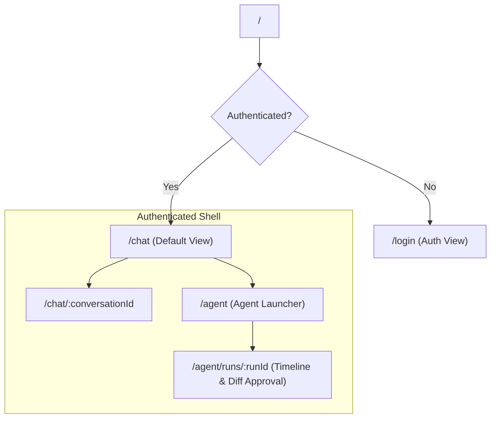
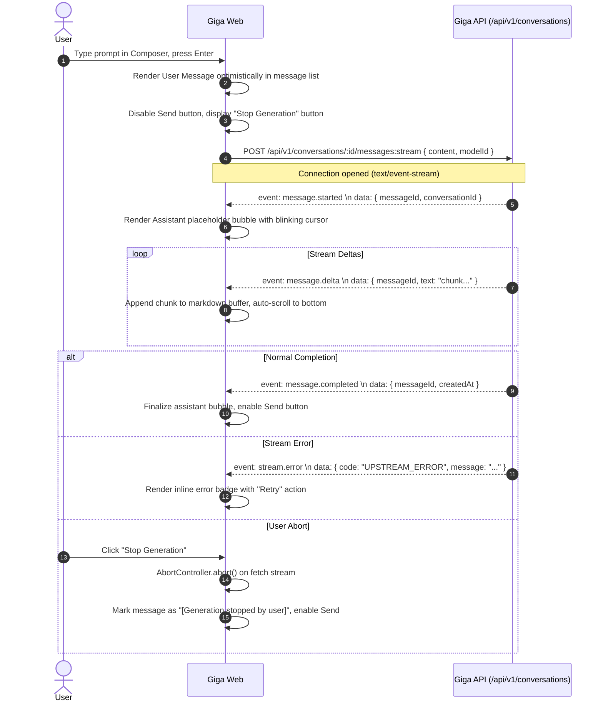
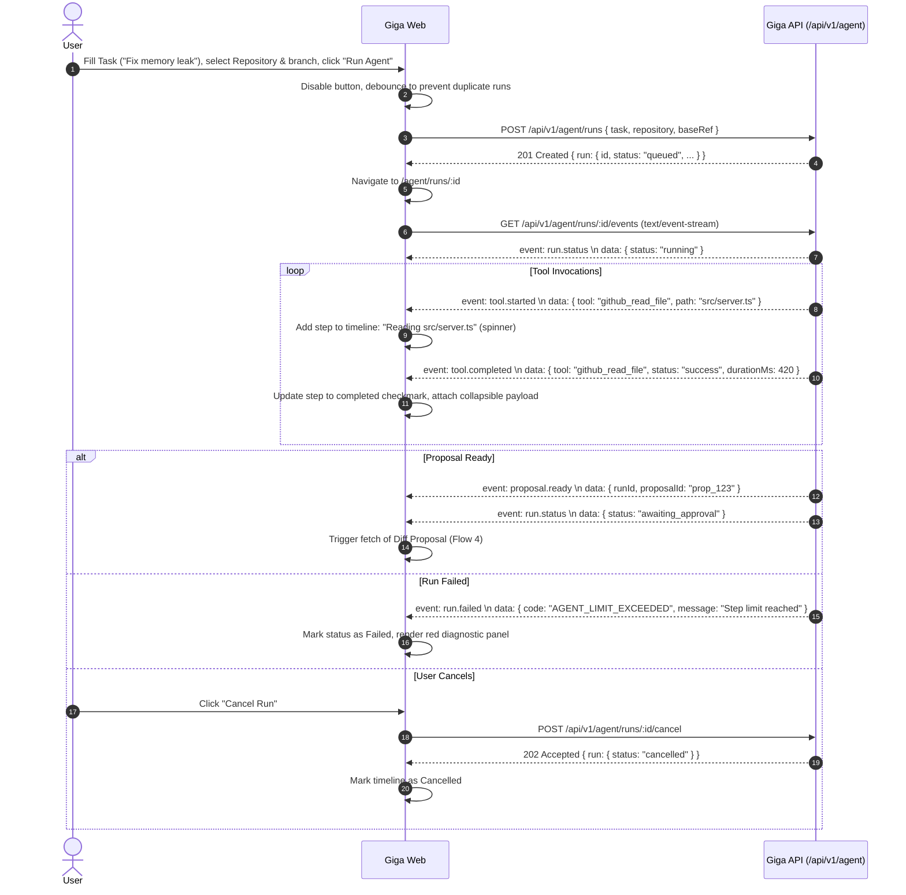
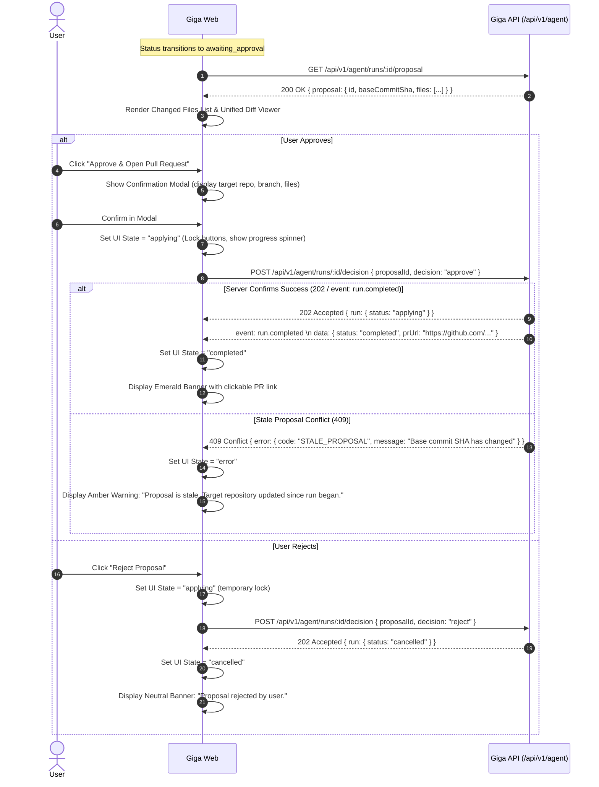

# Giga — Frontend UX Flow Blueprint v0.1

> **Status:** DRAFT / PROPOSED · **Date:** 2026-10-13  
> **Author:** Tráng A Thư (Frontend / UX)  
> **Reviewer:** Trà (Backend / API)  
> **Linear Issue:** [17T-9](https://linear.app/17thedev/issue/17T-9/w1-ux-flows-wireframes-va-api-mocks)  
> **Companion Documents:** [Wireframes Blueprint](WIREFRAMES_V0.1.md) · [API Mapping Spec](API_MAPPING_V0.1.md) · [API Contract v0.1](../../contracts/API_CONTRACT_V0.1.md) · [Architecture Invariants](../../architecture/INVARIANTS_V0.1.md)

---

## 1. Executive Summary & Design Principles

Giga is a developer-oriented cloud web application combining **multi-turn AI Chat** and an **autonomous Coding Agent with human-in-the-loop diff approvals**.

The UX design adheres to the following core tenets:

1. **Deterministic Feedback & Zero Speculative Writes:**
   - Remote modifications to repositories never happen optimistically.
   - An approval action remains strictly in an `applying` state until the server confirms the operation.
2. **Minimalist, High-Density Developer Interface:**
   - Fast, keyboard-first navigation with clean visual hierarchy.
   - Clean slate and neutral grays with purpose-driven accent colors (Indigo for Chat, Amber for awaiting approval, Emerald for success, Rose for errors/conflicts).
   - **No ChatGPT logo, branding, or direct visual imitation.**
3. **Resilient Network & Session Lifecycle:**
   - Graceful degradation for SSE streaming interruptions, server cold-starts (e.g. Render spin-up), expired sessions, and rate limits.
   - Forms and prompt drafts are preserved in browser memory or localStorage during re-authentication.
4. **Universal Responsiveness:**
   - Desktop layout features efficient multi-pane workflows (collapsible history, split agent timeline and code diff viewer).
   - Mobile layout provides distraction-free drawer navigation, stacked timelines, and touch-optimized code inspectability.

---

## 2. Information Architecture & Route Hierarchy



### Route Table

| Route | Access | Layout Structure | Key Purpose |
|---|---|---|---|
| `/login` | Public / Guest | Centered card layout | Session authentication, demo credential guidance, validation errors |
| `/chat` | Protected | 2-pane workspace (Sidebar + Empty Chat) | Start new conversation, browse conversation history |
| `/chat/:conversationId` | Protected | 2-pane workspace (Sidebar + Message Stream) | Multi-turn streaming chat, markdown/code rendering, composer |
| `/agent` | Protected | 2-pane workspace (Sidebar + Launcher) | Configure task prompt, target repository, and base branch |
| `/agent/runs/:runId` | Protected | 2-pane / 3-pane split (Timeline + Diff Viewer) | Monitor live tool execution, inspect unified diff, approve/reject PR |

---

## 3. Screen User Flows & Interaction Details

### Flow 1: Authentication & Session Management

```mermaid
sequenceDiagram
    autonumber
    actor User
    participant Web as Giga Web (SPA)
    participant API as Giga API (/api/v1/auth)
    
    User->>Web: Navigate to application
    Web->>API: GET /api/v1/auth/me (Check Session Cookie)
    alt Session Valid (200 OK)
        API-->>Web: { user: { id, email, displayName } }
        Web-->>User: Render /chat workspace with User Profile
    else Session Invalid or Missing (401)
        API-->>Web: 401 Unauthorized
        Web-->>User: Redirect to /login
    end

    User->>Web: Enter Email & Password, click "Sign In"
    Web->>Web: Client validation (Email format, non-empty password)
    Web->>API: POST /api/v1/auth/login { email, password }
    alt Credentials Valid (200 OK)
        API-->>Web: Set-Cookie: giga_session=...; HttpOnly; Secure; SameSite=Lax
        API-->>Web: 200 { user }
        Web-->>User: Redirect to originally requested route (or /chat)
    else Invalid Credentials (401)
        API-->>Web: 401 { error: { code: "UNAUTHENTICATED", message: "Invalid email or password" } }
        Web-->>User: Display accessible error banner, focus password field
    end
```

#### Detailed States & Feedback:
- **Idle / Clean:** Email and password inputs with accessible labels and placeholder cues.
- **Submitting:** Submit button disabled, shows spinner with accessible text *"Signing in..."*. Inputs are locked.
- **Client Validation Error:** Immediate inline cues below fields (e.g. *"Please enter a valid email address"*).
- **Server Error (401 / 422):** Red alert banner above form with `role="alert"`. Form inputs are preserved.
- **Session Expiration Interceptor:**
  - If any background request returns `401 Unauthorized`, a non-destructive modal dialog appears: *"Your session has expired. Please sign in again to continue."*
  - The current prompt draft or unsaved input in memory is preserved so the user does not lose context upon re-authentication.

---

### Flow 2: Multi-Turn AI Chat & SSE Streaming



#### Detailed States & Feedback:
- **Empty State:**
  - When no conversation is selected or conversation is empty, display welcoming developer dashboard with quick starter prompts (e.g., *"Explain architecture invariants"*, *"Inspect git commit log"*).
- **Composer States:**
  - Auto-growing multiline textarea (up to 8 lines before scrolling).
  - Keyboard submission: `Enter` to send, `Shift + Enter` for newline. Optional toggle for `Ctrl/Cmd + Enter` to send.
  - Active submission disables composer input, switches action button to *"Stop Generation"* (red accent / square stop icon).
- **Streaming Auto-Scroll Policy:**
  - Auto-scroll keeps the latest token in view while the user is at the bottom of the feed.
  - If the user scrolls up to review prior answers, auto-scroll pauses and a floating *"Jump to latest"* pill appears with an unread token indicator.
- **Overlapping Generation Guard (409 Conflict):**
  - If user sends a prompt while a generation is running in another tab, server returns `409 Conflict`.
  - UI shows warning banner: *"A response is already generating in this conversation."*
- **Conversation Management:**
  - **Create:** Click `+ New Chat` triggers `POST /api/v1/conversations` (or initializes local draft conversation).
  - **Delete:** Hover over sidebar item reveals trash icon. Clicking triggers modal dialog: *"Are you sure you want to delete this conversation? This action cannot be undone."* Confirmation calls `DELETE /api/v1/conversations/:id`.

---

### Flow 3: Coding Agent Task Execution & Timeline



#### Detailed States & Feedback:
- **Run Launcher Form:**
  - Repository selector: Validates GitHub owner/repo pattern (`^[a-zA-Z0-9_.-]+/[a-zA-Z0-9_.-]+$`).
  - Base ref selector: Defaults to `main`.
  - Task input: Multiline prompt input with minimum length validation (>= 10 chars).
- **Execution Timeline UI:**
  - Status Pill: Distinct color-coded badge (`queued` [gray], `running` [blue pulse], `awaiting_approval` [amber], `applying` [purple pulse], `completed` [emerald], `failed` [rose], `cancelled` [neutral]).
  - Step List: Monospace timestamps, tool name, targeted file/query, execution duration in milliseconds.
  - Collapsible Inspector: Clicking a tool step expands arguments and redacted output preview for deep verification.
  - Heartbeat & Reconnection: If no SSE event or heartbeat is received within 30 seconds, UI displays a subtle reconnecting indicator and attempts recovery using `Last-Event-ID`.

---

### Flow 4: Diff Inspection & Human-in-the-Loop Approval Gate



#### Detailed States & Feedback:
- **Diff Presentation:**
  - File Summary bar: Shows file count, total additions (`+`), total deletions (`-`), and base commit SHA badge (`sha: 4aff648`).
  - File Navigation: Left-hand or top tab list with badges:
    - `[A]` (Added - Green)
    - `[M]` (Modified - Blue)
    - `[D]` (Deleted - Red)
  - Unified Diff Body:
    - Monospace font (`JetBrains Mono`, `Fira Code`, or system monospace).
    - Line number columns: Old Line #, New Line #, Prefix (`+`, `-`, ` `), Code content.
    - Added lines highlighted with light emerald background; deleted lines with light rose background.
- **Action Controls & Confirmation:**
  - Primary button: *"Approve & Open Pull Request"* (Emerald).
  - Secondary button: *"Reject Proposal"* (Rose outline).
  - Confirmation Modal: Prevents accidental approvals. Re-states target repository, target branch, and notice: *"This action will create a new branch and Pull Request on GitHub under authenticated credentials."*
- **Strict Invariant: No Premature Success:**
  - While server is processing approval, the UI remains strictly in `applying` status.
  - Under no circumstances will the UI declare *"Pull Request Created"* until the server responds with success and provides the verified PR URL.
- **Stale Proposal / Conflict Handling (409):**
  - If another branch was merged or the proposal expired, server returns `409 Conflict`.
  - UI surfaces an actionable conflict banner: *"This proposal was calculated on an earlier commit and cannot be applied safely. Please trigger a new run on current HEAD."* with a direct CTA *"Start New Run"*.

---

## 4. Comprehensive UI State Matrix

| State | Chat Screen Behavior | Agent Workspace Behavior | Diff & Approval Behavior |
|---|---|---|---|
| **Empty** | Friendly welcome card with starter prompt pills. Sidebar shows *"No conversations yet"*. | Form ready with demo repo selected. Run history empty placeholder. | N/A (Only shown when proposal exists). |
| **Loading** | Skeleton loaders for sidebar conversations and message history. | Skeleton pulse on run configuration and past run history. | Skeleton placeholders for diff lines and file tree. |
| **Streaming / Active** | Blinking cursor at end of assistant bubble. Send button becomes Stop button. | Pulse badge on `running` status. Tool steps append with active spinners. | N/A (Proposal not ready during execution). |
| **Success** | Message finalizes with markdown rendering, syntax highlighting, copy button. | Step checkmarks turn green. Status transitions to `awaiting_approval` or `completed`. | Emerald banner appears with verified GitHub PR external link and copy button. |
| **User Abort** | Stream closes immediately; partial message finalized with tag `[Stopped]`. | Timeline marks step as cancelled; sends `POST /cancel` to server. | N/A |
| **Network Error** | Inline rose alert: *"Connection lost. Retrying in 5s..."* with manual *"Retry"* button. | Heartbeat warning pill: *"Reconnecting to event stream..."*. | Toast: *"Failed to submit decision. Please check connection."* Actions re-enabled. |
| **Unauthorized (401)** | Modal overlay: *"Session expired"*. Inputs frozen, draft preserved. | Same modal overlay. Polling and SSE closed. | Same modal overlay. Form state preserved. |
| **Forbidden (403)** | Alert: *"You do not have access to this conversation."* Redirect to `/chat`. | Alert: *"Unauthorized repository access."* | Alert: *"Only run owner can approve proposals."* |
| **Conflict (409)** | Alert: *"Another generation is in progress for this conversation."* | Alert: *"Run is already in a terminal state."* | Stale diff warning: *"Base commit has diverged. Proposal invalidated."* |
| **Rate Limited (429)** | Alert: *"Message limit reached. Please wait X seconds before retrying."* | Alert: *"Model token budget exceeded for current window."* | Alert: *"Too many requests. Please wait."* |
| **Server Spin-up (504/Cold-start)** | Gentle toast: *"Waking up cloud service (Render cold-start)..."* with 45s timeout. | Same cold-start notification with progress indicator. | Same cold-start notification. |

---

## 5. Responsive Behavior & Viewport Layouts

### Desktop (>= 1024px)
- **Navigation:** Persistent left navigation rail (64px width) with quick mode toggle (Chat vs Agent), user avatar, and settings.
- **Sidebar:** Collapsible contextual drawer (280px width) holding conversation history or agent task history.
- **Main View:** High-density center workspace (Chat stream + sticky bottom composer, or Agent timeline + side-by-side Diff Viewer).
- **Diff Viewer:** Two-column split diff or full-width unified diff with sticky action bar at bottom.

### Tablet (768px – 1023px)
- **Sidebar:** Slides out as an off-canvas drawer via top-left hamburger menu.
- **Main View:** Full width. Diff viewer defaults to unified mode to fit horizontal constraints.
- **Modals:** Centered dialogs with 90% viewport width.

### Mobile (< 768px)
- **Top Bar:** Fixed 56px header displaying current screen title, connection status dot, and menu button.
- **Navigation:** Bottom navigation bar or top hamburger slide-over drawer for switching between Chat and Agent modes.
- **Chat Composer:** Fixed at bottom above mobile software keyboard; clean single-line expanding input with Send/Stop icon.
- **Agent Timeline:** Compact vertical timeline with simplified tool step cards.
- **Diff Viewer:** Unified diff only, file list rendered as horizontal scrolling pill tabs, sticky bottom action bar with full-width primary *"Approve"* button.

---

## 6. Accessibility & Keyboard Navigation (WCAG 2.1 AA)

1. **Focus Rings:** All interactive elements feature high-contrast focus rings (`outline: 2px solid #6366f1; outline-offset: 2px;`) visible during keyboard tab navigation.
2. **Keyboard Shortcuts:**
   - `Ctrl + Enter` (or `Cmd + Enter`): Submit chat message or approve confirmed proposal.
   - `Escape`: Close modals, dismiss dropdowns, or abort active generation when composer is focused.
   - `Tab` / `Shift + Tab`: Natural visual focus order across navigation, sidebar, message list, and composer.
3. **Screen Readers & ARIA:**
   - Active streaming responses use `aria-live="polite"` with `aria-busy="true"` until `message.completed` event fires.
   - Tool execution timeline uses `role="log"` with `aria-atomic="false"`.
   - Modals implement `role="dialog"`, `aria-modal="true"`, and automatic focus trap upon opening.
4. **Color Contrast:**
   - Text and essential icons maintain a minimum contrast ratio of `4.5:1` against their backgrounds.
   - Badges and status pills use distinct text labels and icons in addition to color (never convey status through color alone).
